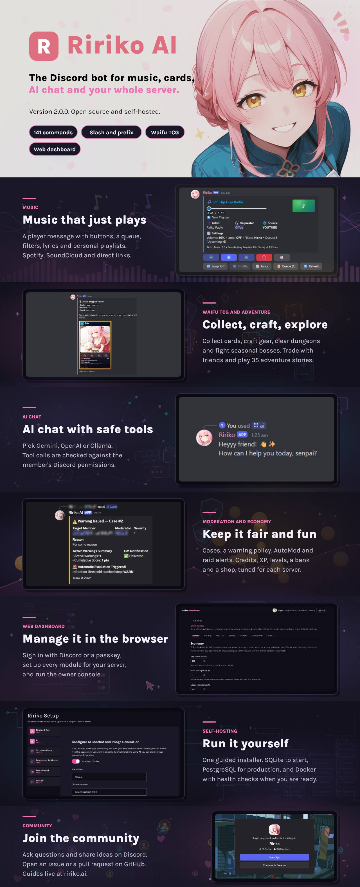

[](https://app.circleci.com/pipelines/gh/RirikoAI/RirikoBot?branch=master)
[](https://app.circleci.com/pipelines/gh/RirikoAI/RirikoBot?branch=develop)
[](https://app.codecov.io/gh/RirikoAI/RirikoBot/tree/develop)
[](https://www.codefactor.io/repository/github/ririkoai/ririkobot/overview/master)
[](https://hub.docker.com/r/ririkoai/ririkobot)

<!-- ALL-CONTRIBUTORS-BADGE:START - Do not remove or modify this section -->
[](#contributors-)<!-- ALL-CONTRIBUTORS-BADGE:END -->


<p align="center">
  
</p>

# Ririko AI 2.0.0

Ririko is a multipurpose Discord bot you host yourself. It plays music, chats with AI, moderates your server, runs an economy with levels, hosts giveaways and mini-games, and has a card game of its own, the Waifu TCG. A web dashboard lets server admins change every setting without a command.

Version 2.0.0 is a full rewrite of RirikoBot 1.4.0 in TypeScript. It keeps every 1.x command, with a slash and a prefix version of each.

| What you get | In short |
| --- | --- |
| Music | Play from YouTube, Spotify, SoundCloud, Deezer and more through Lavalink 4, with a live player message. |
| AI chat and images | Gemini, OpenAI-compatible APIs and Ollama, with tools that respect Discord permissions. |
| Waifu TCG | Card drops, trading, gear, dungeons and seasonal bosses. |
| Moderation | Warnings, cases, AutoMod and raid alerts. |
| Economy and levels | Credits, XP, a daily reward, a bank and a shop. |
| Web dashboard | Sign in with Discord and manage each server from a browser. |

Self-hosting means you run the bot, the dashboard, a PostgreSQL database and a Lavalink audio server on your own machine. Docker starts all four from one command, but the bot is online only while that machine is.

## Quick start with Docker

The quickest start is the starter on npm. You need [Node.js](https://nodejs.org) 20 or newer:

```bash
npx ririko --docker
```

It downloads the release files, runs the setup wizard and asks if it should start Ririko. Leave out `--docker` and it asks you to choose between Docker and a source install. The steps below do the same by hand.

You need [Docker](https://docs.docker.com/engine/install/) 23 or newer with Compose v2, Git, and a Discord account. The steps below are the short form of [Deploy Ririko With Docker](https://ririko.ai/docs/deployment), which explains each one.

1. Clone the repository and check out the release:

   ```bash
   git clone https://github.com/RirikoAI/RirikoBot.git
   cd RirikoBot
   git checkout v2.0.0
   ```

2. Run the setup wizard. It opens in your browser at the address it prints, guides you through the Discord application, checks your values and writes `.env.production`:

   ```bash
   docker run --rm -it -p 127.0.0.1:3999:3999 -v "$PWD:/setup" ririkoai/ririkobot:2 ririko setup --docker --env-file /setup/.env.production --listen 0.0.0.0 --no-open
   ```

3. Start the stack:

   ```bash
   docker compose -f docker-compose.production.yml --env-file .env.production up -d
   ```

4. Add the bot to your server with the invite link on the wizard's **Install** page. Without the wizard link, use the Developer Portal steps in [section 2.6 of the guide](https://ririko.ai/docs/deployment#26-add-the-bot-to-your-server).

5. Register the slash commands:

   ```bash
   docker compose -f docker-compose.production.yml --env-file .env.production exec bot ririko commands:sync --global --all-guilds
   ```

   Then type `/ping` in your server. The bot answers.

Global commands can take a while to show in Discord. Press Ctrl+R in Discord to refresh.

## Find your way

**Run it**

- [Deploy Ririko With Docker](https://ririko.ai/docs/deployment): the full guide behind the quick start, including a public address and a remote Lavalink node.
- [After You Install](https://ririko.ai/docs/after-installing) and [Integrations](https://ririko.ai/docs/adapters): the optional settings and the key each feature needs.
- [Upgrade From Ririko 1.4.0 to 2.0](https://ririko.ai/docs/upgrading-from-1.4) and [Move Your Data](https://ririko.ai/docs/migrations): for an existing 1.4.0 bot.

**Use it**

- [Commands](https://ririko.ai/docs/commands) and [Server Modules](https://ririko.ai/docs/modules): every command and what each module does.
- [Music](https://ririko.ai/docs/music), [AI Chat and Images](https://ririko.ai/docs/ai), [Moderation](https://ririko.ai/docs/moderation) and [Economy and Levels](https://ririko.ai/docs/economy).
- [Web Dashboard](https://ririko.ai/docs/dashboard): sign-in, every page and the owner console.
- [Waifu TCG Player Guide](https://ririko.ai/docs/tcg-player-guide) and [Adventures](https://ririko.ai/docs/adventure-game).

**Build it**

- [CONTRIBUTING.md](CONTRIBUTING.md): how to make a change and open a pull request.
- [SETUP.md](SETUP.md): run Ririko from source on your own machine.
- [Architecture](https://ririko.ai/docs/architecture), [Developer Guide](https://ririko.ai/docs/development), [Database Guide](https://ririko.ai/docs/database) and [Testing Guide](https://ririko.ai/docs/testing).

**Ask**

- Join the [Discord support server](https://discord.gg/UNMZx4qx8G) to ask for help or just chat.
- Open an [issue](https://github.com/RirikoAI/RirikoBot/issues) for a bug or an idea.

## Built with

Node.js 22, TypeScript (strict), pnpm workspaces, Discord.js 14, Drizzle ORM (PostgreSQL and SQLite), Lavalink 4, Next.js 16 and Vitest.

```text
apps/       bot, web dashboard and the ririko command-line tool
packages/   core, database, discord, services, music and ai
assets/     TCG catalogs, installer guides and the images of this page
docs/       the documentation, also published at ririko.ai/docs
```

## Security

Never commit `.env`, tokens, cookies or database files. Report vulnerabilities privately to the maintainers, not in public issues.

## Contributors ✨

Thanks goes to these wonderful people ([emoji key](https://allcontributors.org/docs/en/emoji-key)):

<!-- ALL-CONTRIBUTORS-LIST:START - Do not remove or modify this section -->
<!-- prettier-ignore-start -->
<!-- markdownlint-disable -->
<table>
  <tbody>
    <tr>
      <td align="center" valign="top" width="14.28%"><a href="https://angel.net.my"><br /><sub><b>Earnest Angel</b></sub></a><br /><a href="https://github.com/RirikoAI/RirikoBot/commits?author=earnestangel" title="Code">💻</a> <a href="#design-earnestangel" title="Design">🎨</a> <a href="#infra-earnestangel" title="Infrastructure (Hosting, Build-Tools, etc)">🚇</a> <a href="https://github.com/RirikoAI/RirikoBot/commits?author=00ZenDaniel" title="Tests">⚠️</a></td>
      <td align="center" valign="top" width="14.28%"><a href="https://github.com/True-Aki"><br /><sub><b>Aki</b></sub></a><br /><a href="https://github.com/RirikoAI/RirikoBot/commits?author=True-Aki" title="Code">💻</a> <a href="#design-True-Aki" title="Design">🎨</a><a href="https://github.com/RirikoAI/RirikoBot/commits?author=00ZenDaniel" title="Tests">⚠️</a></td>
      <td align="center" valign="top" width="14.28%"><a href="https://github.com/00ZenDaniel"><br /><sub><b>Muhammad Afiq Danial Bin Azruliswal</b></sub></a><br /><a href="https://github.com/RirikoAI/RirikoBot/commits?author=00ZenDaniel" title="Tests">⚠️</a> <a href="https://github.com/RirikoAI/RirikoBot/commits?author=00ZenDaniel" title="Code">💻</a></td>
    </tr>
  </tbody>
</table>

<!-- markdownlint-restore -->
<!-- prettier-ignore-end -->

<!-- ALL-CONTRIBUTORS-LIST:END -->

This project follows the [all-contributors](https://github.com/all-contributors/all-contributors) specification. Contributions of any kind welcome!

## License

[MIT](LICENSE)
