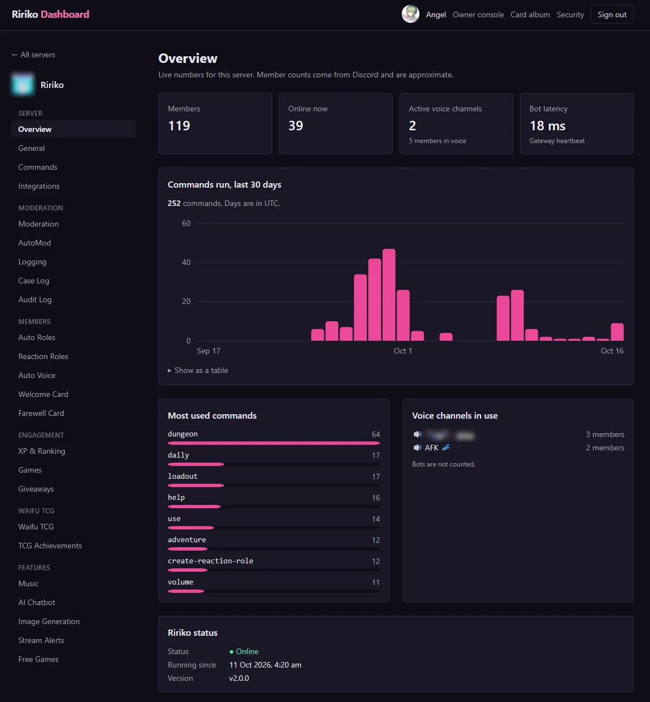

# Web Dashboard

The dashboard is a website where server admins change Ririko's settings, read logs and see statistics. You do not need to remember commands. Everything you change on the dashboard works at once, and the bot picks it up within seconds.

## 1. Sign In

You can sign in if you have the **Manage Server** or **Administrator** permission in a server where Ririko is.

1. Open the dashboard address that the host gave you. The default for a local install is <http://localhost:3000>.
2. Click **Sign in with Discord** and approve the request. Ririko asks only to see your name and your list of servers.
3. Pick your server on the **Servers** page.

The Servers page lists the servers where you can manage Ririko. If Ririko is not in a server yet, the page shows an **Invite Ririko** button.

If you lose the permission on Discord, or if Ririko leaves the server, the dashboard stops showing that server within a minute.

## 2. Keep Your Account Safe

### 2.1. Sessions

- A session ends after 30 minutes without activity, or after 12 hours.
- Open **Account**, then **Sessions**, to see where you are signed in. You can sign out one session or all other sessions.
- When you sign in from a new browser, Ririko sends you a direct message.

### 2.2. Passkeys

A passkey is a second step, such as a fingerprint or a security key. Passkeys are optional, but we recommend them.

1. Open **Account**, then **Passkeys**.
2. Click to add a passkey and follow your browser.

After you add a passkey, every sign-in needs a passkey check. Someone who steals your Discord account still cannot use the dashboard.

Some changes always need a passkey check from the last 5 minutes:

- the warning policy on the **Moderation** page,
- every change on the **Reaction Roles** page,
- everything in the owner console (section 6),
- removing a passkey.

If you have no passkey, you cannot make these changes. The page links to the Passkeys page. Ririko sends you a direct message when someone adds or removes a passkey.

If you lose your passkey, the operator of the bot can reset it with `ririko passkeys:reset <user_id>`. See [deployment.md](deployment.md).

### 2.3. Your Card Album

**Account**, then **Card Album**, shows your own Waifu TCG cards, 24 on a page, newest first. You can filter by rarity or show only favorites. It is read only. Use `/cards` in Discord to equip, trade or dismantle cards.

## 3. Pages for Each Server

The sidebar groups the pages. This table tells you what each page does and where to read more.

| Group | Page | What it does | More |
|---|---|---|---|
| Server | Overview | Shows statistics (section 4.1). | Section 4.1 |
| Server | General | Sets the prefix and the time zone. | Section 4.2 |
| Server | Commands | Turns commands off, limits them to roles, sets cooldowns. | [commands.md](commands.md) |
| Server | Integrations | Shows which outside services the host has set up. | Section 4.3 |
| Moderation | Moderation | Sets the warning policy. | [moderation.md](moderation.md) |
| Moderation | AutoMod | Sets the AutoMod rules. | [moderation.md](moderation.md) |
| Moderation | Logging | Picks the log channel and sets the event logs. | Section 4.4 |
| Moderation | Case Log | Lists moderation cases. | [moderation.md](moderation.md) |
| Moderation | Audit Log | Lists changes made on the dashboard. | Section 4.5 |
| Members | Auto Roles | Gives roles to new members and bots. | [modules.md](modules.md) |
| Members | Reaction Roles | Builds role buttons and menus. | [modules.md](modules.md) |
| Members | Tickets | Turns support tickets on and sets the category, staff roles and transcript channel. | [modules.md](modules.md) |
| Members | Auto Voice | Sets up "Join to Create" channels. | [modules.md](modules.md) |
| Members | Welcome Card | Sets the welcome card. | [modules.md](modules.md) |
| Members | Farewell Card | Sets the farewell card. | [modules.md](modules.md) |
| Engagement | XP & Ranking | Sets XP rules, level-up messages and level role rewards. | Section 4.7 and [economy.md](economy.md) |
| Engagement | Games | Sets wager limits, game switches and cooldowns. | [modules.md](modules.md) |
| Engagement | Giveaways | Ends giveaways and rerolls winners. | [modules.md](modules.md) |
| Waifu TCG | Waifu TCG | Sets card drops and the TCG Manager Role. | [waifu-tcg.md](waifu-tcg.md) |
| Waifu TCG | TCG Achievements | Shows how many members unlocked each achievement. | [waifu-tcg.md](waifu-tcg.md) |
| Features | Music | Sets the default volume, music channel and DJ role. | [music.md](music.md) |
| Features | AI Chatbot | Sets the AI channel, style, persona, tools and model. | [ai.md](ai.md) |
| Features | Image Generation | Sets image defaults and limits. | [ai.md](ai.md) |
| Features | Stream Alerts | Adds streamers and sets alerts. | [modules.md](modules.md) |
| Features | Free Games | Sets the free games channel. | [modules.md](modules.md) |

Every page has a **Save** button. Ririko shows an error under a field if a value is not valid. Nothing is saved until all fields are valid.

## 4. Pages Explained

### 4.1. Overview

The Overview page shows:

- the number of members and how many are online,
- the number of voice channels in use,
- a chart of the commands used in the last 30 days, and the most used commands,
- Ririko's latency, version and uptime.

If Ririko is offline, the page shows that. Voice activity then shows as unknown.



### 4.2. General

| Setting | What it does |
|---|---|
| Command prefix | Starts text commands, such as `!help`. It has 1 to 5 characters and no spaces. Slash commands do not change. |
| Time zone | An IANA name, such as `Asia/Kuala_Lumpur`. Ririko uses it for reminders and for times it shows in this server. |

### 4.3. Integrations

This page is read only. It lists the outside services (Discord, AI, images, streams, music) and whether each one is configured. It never shows a key. To change them, the host edits `.env`. See [adapters.md](adapters.md).

### 4.4. Logging

The Logging page has two forms.

**Log channel.** Pick the log channel. Ririko posts moderation cases, raid alerts and notices of dashboard changes there. Ririko needs View Channel, Send Messages and Embed Links in the channel.

**Event logs.** Event logs record what happens in your server, one embed for each event. They are different from the log channel: the log channel holds moderation cases, raid alerts and notices, and event logs hold what members and bots do in the server. Every event log is off until you pick a channel for it, so a server that upgrades sees no new posts.

Pick a channel for each kind of event you want. Leave the picker on **Off** to skip that kind. You can use one channel for all four or a different channel for each.

| Log | What Ririko posts |
|---|---|
| Message log | A message that was edited (the text before and after, and a link to the message), a message that was deleted (its text and the names of its attachments), and a bulk delete (the count, and a text file with the messages Ririko still had). |
| Member log | A member joined (how old the account is, and the member count), a member left (when they joined and their roles), a nickname change, roles added or removed, a timeout set or lifted, and a ban or unban (with the reason). |
| Server log | A channel or role created, deleted or renamed. Other changes, such as permissions, are not logged. |
| Voice log | A member joined, left or moved between voice channels. Mute, deafen, camera and stream changes are not logged. |

Each embed shows the member or channel (a mention and the ID) and the time. Mentions inside logged text never ping anyone. The colour tells the kind of event: green for created, joined or lifted, red for deleted or left, amber for a change.

Rules that decide what is logged:

- **Ignored channels.** Messages in the channels you pick are not logged, such as a staff chat. This includes the threads under them and the text chat of a voice channel you pick. Member, server and voice events are always logged. Pick up to 25 channels.
- **Ignore bots' messages and voice activity.** On by default. Messages and voice activity of bots are not logged, so a music bot does not fill the voice log. Member events for bots, such as a bot that joins, are always logged, because a new bot can be a risk.
- Messages inside the message log channel itself are not logged, so the log does not feed on itself.
- An edit that did not change the text (a link preview that loaded) is not logged.

What to know:

- Ririko needs View Channel, Send Messages, Embed Links and Attach Files in each event log channel. Attach Files is for the text file of a bulk delete. If Ririko cannot post, it skips the event and writes a note in the host's console. It never retries later.
- Ririko does not store the posts. The text of a deleted or edited message comes from the messages that Ririko saw in about the last hour. The memory is swept every 30 minutes and starts empty when the bot restarts. For an older message, the post says "Content unknown".
- Ririko does not show who deleted a message or who banned a member. That needs the Discord audit log, and Ririko does not read it for event logs. Look in the Discord audit log for that.
- A change on this page takes effect at once. Ririko reads the settings again within 5 minutes at the latest.
- Ban and unban events need the **Guild Moderation** gateway intent. It is not a privileged intent, so the host does not change anything in the Developer Portal. It takes effect after the bot restarts on a version that has it. Until then, the other events work and bans are not logged.
- What Ririko posts and keeps is described in the [privacy policy](legal/privacy.md), section 3.17.

With the command line, the keys are `eventlogs.messageChannelId`, `eventlogs.memberChannelId`, `eventlogs.serverChannelId`, `eventlogs.voiceChannelId`, `eventlogs.ignoredChannelIds` and `eventlogs.ignoreBots`. Dashboard changes show in the Audit Log as "Event Logs settings changed".

### 4.5. Audit Log

The Audit Log lists the changes made to the server's settings, newest first, 25 on a page. Each entry shows who changed what, when, and the old and new value of each field. It also lists changes made with `ririko guild:config`. It does not show addresses or browsers.

### 4.6. Change Notices

When someone changes a setting on the dashboard, Ririko posts a notice in the log channel. The notice says who changed which module and which fields. Text that members typed is shown as plain code and never pings anyone.

### 4.7. XP & Ranking

The XP & Ranking page has two forms. You need the **Manage Server** permission.

**XP settings.** The first form sets level-up messages, the XP rate, the channels and roles that earn no XP, and voice rewards. Each setting is in [economy.md](economy.md), section 7.

**Level role rewards.** The second form gives members a role when they reach a level.

- Each row has a level (1 to 1000) and a role. Choose **Add reward** for a new row and **Remove** to delete one. A server can have up to 25 rewards. **Add reward** is greyed out at 25.
- The role picker lists the roles that Ririko can give. A role that another row already uses is not shown again. A saved role that Ririko can no longer give is marked, so you can replace it.
- **Keep lower reward roles** is on by default. On, a member keeps the reward roles of every level they reached. Off, a member holds only the role of their highest reward.
- Ririko does not save a role that was deleted or that it cannot give, and it does not save a level or a role that is used twice. It shows an error and saves nothing.
- Save the form to apply it. The new rewards are given at the next level-up. To give them to members who already have the level, run `/levelroles action:sync` in Discord.

The XP form and the rewards form save on their own. A save on the rewards form shows in the Audit Log as "Level Roles settings changed". Ririko needs the **Manage Roles** permission and a role above the reward roles. See [economy.md](economy.md), section 8, for when roles are given, the keep switch, sync and the permissions.

With the command line, the keys are `levelroles.rewards` (a JSON list, for example `[{"level":5,"roleId":"123456789012345678"}]`) and `levelroles.keepPreviousRoles`.

## 5. Command Line

Every setting on a server page can also be set with the command line. This helps when you manage many servers.

```bash
ririko guild:config <server_id>
ririko guild:config <server_id> <key>
ririko guild:config <server_id> <key> <value>
```

- With no key, the command lists all keys.
- With a key, it shows the value.
- With a key and a value, it sets the value.

The command line uses the same checks as the dashboard. Its changes appear in the Audit Log. See [development.md](development.md).

## 6. Owner Console

Some settings are the same for every server: the economy values, the item shop, the card game rules, the dungeon seasons, the card game items and the achievements. Only bot owners can change them. Bot owners are the users in `BOT_OWNER_ID`.

1. Add your Discord user ID to `BOT_OWNER_ID` in `.env` and restart the bot.
2. Add a passkey to your account (section 2.2).
3. Sign in. A link to the **Owner console** appears in the header.
4. Pick a page. Each save needs a passkey check from the last 5 minutes. The page offers **Confirm with passkey and save** when it needs one.

| Page | What it does |
|---|---|
| Economy | Daily reward, streak bonus and bank capacity. See [economy.md](economy.md). |
| Item shop | The items of the `/shop` command. See [economy.md](economy.md). |
| Waifu TCG | Market tax, listing time and energy rules. See [waifu-tcg.md](waifu-tcg.md). |
| Dungeon | Seasons, bosses and floor loot. See [waifu-tcg.md](waifu-tcg.md). |
| TCG items | The items of the card game town shop. See [waifu-tcg.md](waifu-tcg.md). |
| Achievements | The text and rewards of achievements. See [waifu-tcg.md](waifu-tcg.md). |
| Servers | Every server that Ririko is in, who invited it, and how many commands each server used in 30 days. Read only. |

Other people get a "not found" page when they open the owner console.

## 7. Host Setup

The setup wizard (`pnpm installer`, see [SETUP.md](https://github.com/RirikoAI/RirikoBot/blob/master/SETUP.md#31-with-the-setup-wizard)) writes these values for you. It also makes the `SECRET_VAULT_KEY` and checks with Discord that the client secret is right.

The dashboard needs these values in `.env`:

| Variable | What it does |
|---|---|
| `DISCORD_CLIENT_SECRET` | The OAuth2 secret of your Discord application. |
| `DASHBOARD_URL` | The public address of the dashboard. |
| `SECRET_VAULT_KEY` | A key that encrypts sessions. Make one with `openssl rand -hex 32`. If you change it, everyone is signed out. |
| `BOT_OWNER_ID` | The user IDs of the bot owners, separated by commas. |
| `CLIENT_IP_HEADER` | Optional. The header that holds the real client address, such as `cf-connecting-ip` behind Cloudflare. Set it only if every request comes through that proxy. |

Steps:

1. Follow section 8.1 of [SETUP.md](https://github.com/RirikoAI/RirikoBot/blob/master/SETUP.md) for a source install, or section 2.8 of [deployment.md](deployment.md) for Docker.
2. In the Discord Developer Portal, open **OAuth2** and add `<DASHBOARD_URL>/api/auth/callback` as a redirect.
3. Start the bot first. It creates the database tables the dashboard needs.
4. Start the dashboard.

Optional: let people invite Ririko from the dashboard. A dashboard invite records who added the bot.

1. In the Developer Portal, open **OAuth2** and add `<DASHBOARD_URL>/api/invite/callback` as a redirect.
2. Open **Installation** and set the Install Link to **Custom URL** `<DASHBOARD_URL>/api/invite`.
3. Optional: open **Bot** and turn on **Requires OAuth2 Code Grant**. Do this last, only after steps 1 and 2 work. Without them, every invite fails.

The dashboard uses the `__Host-` cookie prefix. Browsers accept it only on HTTPS or on `localhost`. Put the dashboard behind a proxy that sets the `X-Forwarded-For` header, or set `CLIENT_IP_HEADER`. Never open it over plain HTTP on a LAN address.

## 8. Limits

- The dashboard allows 30 changes in a burst and then about 1 each second for each person. Sign-in requests are limited to 20 a minute for each address.
- The dashboard never shows keys or passwords.
- Giveaways are created in Discord, not on the dashboard.
- The dashboard changes only what the bot reads. If a setting is not on a page, the bot does not use it.
