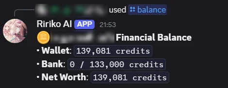
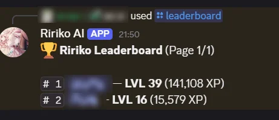
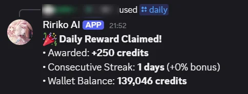

# Economy and Levels

Ririko has credits (money) and XP (experience). Members earn both by chatting, by being in voice channels, by claiming a daily reward and by playing games. They spend credits in the shop, in mini-games and in the card game.

## 1. How It Works

- **Credits** are the money of Ririko. Your credits are the same in every server. Each member has a wallet and a bank.
- **XP** is kept for each server. XP gives you a level in that server.
- **Karma** is a small score that members give each other in a server.
- A **profile card** is a picture that shows your level, rank and credits, and the Waifu TCG card you have equipped.

Server admins cannot set the number of credits that members earn. This stops one server from creating credits for everyone. Bot owners set the global values (see section 9).

**Turn it on.** The economy is always on. Admins can change how XP works in their server on the dashboard **XP & Ranking** page (see section 7).

## 2. Commands

All economy commands are open to everyone.

### 2.1. Credits and Bank

| Command | Aliases | Options | What it does |
|---|---|---|---|
| `/balance` | `bal`, `money` | `target` (member) | Shows the wallet, bank and net worth. |
| `/daily` | `d` | None | Claims the daily reward. |
| `/deposit` | `dep` | `amount` (required) | Moves credits from the wallet to the bank. Type a number or `all`. |
| `/withdraw` | `with` | `amount` (required) | Moves credits from the bank to the wallet. Type a number or `all`. |
| `/pay` | `give`, `transfer` | `target` (required), `amount` (required, at least 1) | Sends credits from your wallet to a member. You cannot pay yourself. |

The reply to `/balance` shows the wallet, the bank and the net worth:

### 2.2. Ranking and Profile

| Command | Aliases | Options | What it does |
|---|---|---|---|
| `/leaderboard` | `lb`, `top` | `scope` (`server` or `global`), `page` | Shows the XP ranking. |
| `/profile` | `rank` | `target` (member), `background` (link) | Shows a profile card. It also shows the Waifu TCG card the member has equipped. With a link or an attached image, it sets your own background. |
| `/karma` | `k` | `action` (`view` or `give`), `target` (member) | Shows karma. With `give`, you give 1 karma to another member. You cannot give karma to yourself. Server only. |

The reply to `/leaderboard` ranks members by level and XP:

The profile card uses the member's server nickname, and a status dot only when Discord reports the member's status. The right side of the card shows the member's equipped Waifu TCG card. To equip one, use `/card action:equip id:<card>` (see the [player guide](tcg-player-guide.md)). A member with no equipped card sees an empty slot with this hint. If the card picture cannot be loaded, the profile card still posts without it.

Profile background rules:

- The image can be at most 1200 x 400 pixels and 5 MB.
- The link must be public. Ririko saves a copy of the image.
- You can use a link, or attach an image when you use the prefix form.
- An image that is smaller than the card, or has another shape, is scaled to cover the card and cropped at the centre. It is not stretched.

### 2.3. Shop and Items

| Command | Aliases | Options | What it does |
|---|---|---|---|
| `/shop` | `store` | `action` (`list` or `buy`), `item` (item code), `quantity` | Lists the shop. With `buy`, buys an item. |
| `/inventory` | `inv`, `bag` | `target` (member) | Lists the items of a member. |
| `/use` | `consume` | `item` (item code, required), `quantity` | Uses an item from your bag. |

Every item has a code. `/shop` and `/inventory` show it. You type the code in `/shop buy` and in `/use`.

The shop starts with these items:

| Code | Name | Price | What it does |
|---|---|---|---|
| `candy_minor` | Minor Energy Candy | 100 | Restores 20 energy. You can buy 1 each day. |
| `stamina_potion` | Stamina Potion | 350 | Restores 50 energy. You can use 3 each day. |
| `exp_potion_small` | Small EXP Potion | 250 | Gives 150 XP in the server where you use it. |
| `profile_bg_voucher` | Profile Background Voucher | 1500 | A cosmetic voucher. |

Energy is used by the card game. See [tcg-player-guide.md](tcg-player-guide.md). Bot owners can add and change items (see section 9).

## 3. How You Earn Credits and XP

| Activity | Credits | XP | Limit |
|---|---|---|---|
| Send a chat message | 20 | 15 to 25 | Once every 60 seconds |
| Be in a voice channel | 35 | 40 | Each minute, if an admin turned on voice rewards |
| `/daily` | See section 4 | None | Once each reset day |
| Win a mini-game | You get your wager back, doubled | None | See [modules.md](modules.md) |
| Card game and adventures | Listed on their pages | Listed on their pages | See [waifu-tcg.md](waifu-tcg.md) and [adventure-game.md](adventure-game.md) |

The XP of a chat message and of a voice minute follow the XP rate of the server.

Ririko pays nothing for spam. A message earns nothing when:

- it is shorter than 5 characters,
- it is almost the same as one of your last few messages (80% or more alike),
- it is sent at an inhuman speed. You then wait 30 minutes before you earn again.

Voice rewards need all of these:

- An admin turned on **Voice rewards**.
- You are with at least one other member. Two members are the least.
- You are not muted or deafened.
- You are not in the AFK channel.
- You are not in a no-XP channel and you do not have a no-XP role.

## 4. Daily Reward

`/daily` gives credits and builds a streak.

- The base reward is 250 credits.
- Each further day in a streak adds 5%. The bonus stops at +150%.
- You can claim once each reset day. A new day starts at 00:00 in GMT+8 by default.
- If you miss 1 or 2 days, you keep your streak. The missed days are skipped, not counted. A streak of 15 days with 2 missed days continues at 16.
- If you miss 3 days or more in a row, the streak starts again. That claim counts as day 1.

The host can change the reset time and the number of days you may miss. See section 10.

## 5. Bank

- The wallet holds credits you carry. You can lose them in games.
- The bank is safe. Games cannot take credits from it.
- Bank capacity is 10,000 credits plus 2,500 for each level. Your level here is the level of your XP added together across all servers.
- If your capacity gets lower, you keep your credits. You can withdraw them, but you cannot deposit more.

## 6. Levels

To go from level L to level L+1 you need `5 x L x L + 50 x L + 100` XP. Level 0 to 1 takes 100 XP. Level 1 to 2 takes 155 XP.

- When you level up, Ririko can announce it (see section 7) and give you a role (see section 8).
- You can turn level-up messages off for yourself.
- A higher level raises your bank capacity and your card game energy.

## 7. Server XP Settings

You need the **Manage Server** permission.

1. Open the dashboard and pick your server. See [dashboard.md](dashboard.md).
2. Open the **XP & Ranking** page.
3. Change the settings.
4. Save.

| Setting | What it does |
|---|---|
| Announce level-ups | Turns level-up messages on or off. Members who turned them off for themselves are never announced. |
| Level-up channel | Where the messages go. Without one, Ririko posts in the channel of the level-up. Voice level-ups are announced only here. |
| XP rate (%) | 100 is normal. 200 doubles XP. 0 turns XP off. The most is 300. |
| No-XP channels | Chat and voice channels that earn no XP. Up to 50. Threads follow their channel. |
| No-XP roles | Members with these roles earn no XP. Up to 25. |
| Voice rewards | Turns on credits and XP for voice time. It is off by default. |

You can also use the command line: `ririko guild:config <server> xp.<key> <value>`.

Level role rewards are on the same page. See section 8.

## 8. Level Role Rewards

A level role reward is a role that Ririko gives to a member who reaches a level. For example, level 5 gives `@Regular` and level 20 gives `@Veteran`. Rewards are for one server. They use the XP that the member has in that server.

You need the **Manage Server** permission for the dashboard. The commands need **Manage Roles**, **Manage Server** or **Administrator**.

### 8.1. Set the Rewards

**Dashboard.** Open the **XP & Ranking** page. Under the XP form is a second form, **Level role rewards**.

1. Choose **Add reward**.
2. Type the level, from 1 to 1000.
3. Pick the role.
4. Repeat for each reward. Use **Remove** to delete a row.
5. Choose whether to keep lower reward roles (see section 8.3).
6. Save.

The picker shows only the roles that Ririko can give. A server can have up to 25 rewards. Each level and each role can be used once. Ririko does not save a role that was deleted or that it cannot give, and it shows an error.

**Command.** You can set up the rewards in Discord instead of the dashboard, with `/levelroles`, or `!levelroles` with the prefix. For example, `/levelroles action:add level:5 role:@Regular` gives `@Regular` at level 5, and `/levelroles action:stack enabled:false` turns off keeping lower reward roles.

| Command | What it does |
|---|---|
| `/levelroles action:list` | Shows the rewards and whether lower roles are kept. Everyone can use it. It is the default. |
| `/levelroles action:add level:5 role:@Regular` | Gives `@Regular` at level 5. If level 5 already has a reward, the new role replaces it. |
| `/levelroles action:remove level:5` | Stops the reward of level 5. |
| `/levelroles action:sync` | Gives the rewards to members who already have the level (see section 8.4). |
| `/levelroles action:stack enabled:false` | Turns the keep lower reward roles switch on (`enabled:true`) or off (see section 8.3). With no value, it shows the current setting. |

The prefix form is `!levelroles add 5 @Regular`, `!levelroles remove 5`, `!levelroles sync` and `!levelroles stack off` (or `on`). In the prefix form you can write the role as a mention, an ID or its exact name.

Everyone can use `list`. The other actions need **Manage Roles**, **Manage Server** or **Administrator**. The commands use the same rules as the dashboard. `add` also refuses `@everyone`, a role that belongs to an integration, and a role that is not below Ririko's highest role. The command line works too: `ririko guild:config <server> levelroles.rewards <json>` and `levelroles.keepPreviousRoles`. Changes from the dashboard, the commands and the command line show in the Audit Log as "Level Roles settings changed". A change takes effect at once. Ririko reads the settings again within 5 minutes at the latest.

### 8.2. When Ririko Gives the Roles

- **Every level-up.** When a member levels up from chat, from voice or from an item, Ririko gives the reward roles for their new level. This happens even if level-up messages are off or the member turned them off for themselves.
- **When a member comes back.** XP stays when a member leaves. When they join the server again, Ririko gives the roles for their level again. Bots get no rewards.
- **Added later.** A new reward is not given at once. Ririko gives it when a member next levels up, or when you run a sync (see section 8.4).

The role comes from the member's level, not from the levels they just passed. A member who jumps from level 3 to level 22 gets the roles for 5 and 20. Ririko writes "Level 22 reward" as the reason in the Discord audit log. If you use event logs, the member log shows the role change. See [dashboard.md](dashboard.md).

### 8.3. Keep Lower Reward Roles

This switch is on by default.

- **On.** A member keeps the reward roles of every level they reached. At level 22 they hold the roles of level 5 and level 20.
- **Off.** A member holds only the role of their highest reward. At level 22 they hold the role of level 20, and Ririko removes the other reward roles, also those of higher levels.

Ririko never removes a role that is not a reward. Roles from other bots, staff roles and roles that members pick for themselves stay as they are.

To change the switch in Discord, run `/levelroles action:stack enabled:false` (or `!levelroles stack off`). The change applies at each member's next level-up. Run `/levelroles action:sync` to apply it to members who already have the roles.

### 8.4. Sync

`/levelroles action:sync` gives the rewards to members who reached a level before you added the reward. You need it after you set the first rewards on a server that already has levels.

- Ririko checks the members who have at least the lowest reward level. It works through them in groups of 100, so it can take a while on a big server.
- It says that it started. When it ends, it tells you how many members it checked and how many roles it added and removed.
- Members who left the server are skipped.
- Only one sync runs in a server at a time. Run it again after the first one ends.
- Ririko never starts a sync by itself.

### 8.5. Remove a Reward

When you remove a reward, members keep the role they already have. Ririko does not take it away and no longer manages it. Delete the role in Discord, or remove it from members yourself, if you want it gone.

### 8.6. What Ririko Needs

- The **Manage Roles** permission.
- A role that sits above every reward role. Open **Server Settings**, then **Roles**, and drag Ririko's role above them. Discord allows a bot to give only roles below its own highest role.
- Reward roles that are not `@everyone` and not managed by an integration (a bot or a booster role).

Ririko skips a role that it cannot give and goes on with the others. It does not tell the member. If Discord refuses a change, Ririko writes a note in the host's console and tries again at the next level-up. If Ririko has no Manage Roles, `/levelroles action:add` and the dashboard still save the reward and warn you, so you can set rewards before you fix the permission. A sync does not start, and Ririko tells you why.

What Ririko stores is only the level and the role ID of each reward, with the switch, for each server. It stores no member data for this. See the [privacy policy](legal/privacy.md).

## 9. Global Settings for Bot Owners

Credits, the daily reward, the bank and the shop are the same in every server. Bot owners (the users in `BOT_OWNER_ID`) change them. A passkey is required. See [dashboard.md](dashboard.md).

1. Open the dashboard and go to the **Owner console**.
2. Open **Economy** for the values below, or **Item shop** for items.
3. Change the values and save.

| Setting | Default | Range |
|---|---|---|
| Daily base reward | 250 | 0 to 1,000,000 |
| Streak bonus for each further day (%) | 5 | 0 to 100 |
| Largest streak bonus (%) | 150 | 0 to 1,000 |
| Bank capacity at level 0 | 10,000 | 0 to 1,000,000,000 |
| Bank capacity for each level | 2,500 | 0 to 10,000,000 |

You can also run `ririko economy:config [key] [value]`.

Each shop item has a code, a name, a price, a rarity, a category, an icon, a daily limit and an effect. The code has 2 to 32 lowercase letters, digits or underscores. It cannot change after you save it. An item that members hold, or an item from the starting list, can be retired but not deleted.

## 10. Reset Time Settings for Hosts

All daily systems use one reset time. These settings are in `.env`.

| Variable | Default | What it does |
|---|---|---|
| `RIRIKO_RESET_OFFSET_MINUTES` | `480` | Minutes ahead of UTC. 480 is GMT+8. |
| `RIRIKO_RESET_TIME` | `00:00` | The reset time of day, in that offset. |
| `RIRIKO_RESET_TIME_DAILY` | The value above | The reset time for `/daily`. |
| `RIRIKO_RESET_TIME_ENERGY` | The value above | The reset time for card game energy. |
| `RIRIKO_RESET_TIME_ENERGY_POTIONS` | The value above | The reset time for the daily energy potion limit. |
| `RIRIKO_RESET_TIME_TCG_SHOP` | The value above | When the card game town shop changes stock. |
| `RIRIKO_RESET_TIME_SHOP_PURCHASES` | The value above | The reset time for the daily purchase limits of the shop. |
| `RIRIKO_DAILY_STREAK_FORGIVENESS` | `3` | Days in a row you can miss before the streak ends. 0 turns forgiveness off. |

Restart the bot after you change them. See [deployment.md](deployment.md).
