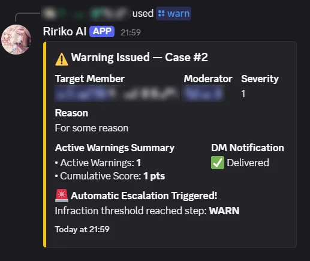

# Moderation

Ririko helps your staff keep the server safe. It can warn, time out, kick and ban members. It records every action as a case. It can also remove spam and invite links for you, and warn staff about raids.

## 1. Turn It On

Moderation commands work as soon as the bot is in your server. Follow these steps to finish the setup.

1. **Give Ririko the permissions it needs.** Each command needs a Discord permission (see section 2). Ririko needs the same permission. Move the Ririko role above the roles of the members you want to moderate.
2. **Pick a log channel.** Open the dashboard **Logging** page and pick a channel. Ririko needs View Channel, Send Messages and Embed Links there. The log channel receives cases, raid alerts and notices of dashboard changes.
3. **Check AutoMod.** Open the dashboard **AutoMod** page. See section 5.
4. **Check the warning policy.** Open the dashboard **Moderation** page. See section 4.

To open the dashboard, see [dashboard.md](dashboard.md). All moderation commands work in a server only.

## 2. Commands

For each command, the person who runs it needs the permission in the table. A member cannot act on someone whose highest role is equal to or above their own role. Ririko follows the same rule.

| Command | Aliases | Permission | Options |
|---|---|---|---|
| `/warn` | `w` | Timeout Members | `user` (required), `reason` (required), `severity` (1 to 5, default 1), `send_dm` (default true) |
| `/timeout` | `mute`, `to` | Timeout Members | `user` (required), `duration` (required, such as `10m`, `1h`, `1d`, `7d`), `reason`, `send_dm` |
| `/untimeout` | `unmute` | Timeout Members | `user` (required), `reason` |
| `/kick` | `boot` | Kick Members | `user` (required), `reason`, `send_dm` |
| `/softban` | `sb` | Ban Members | `user` (required), `days` (1 to 7, default 1), `reason`, `send_dm` |
| `/ban` | `b` | Ban Members | `user` (required), `days` (0 to 7, default 0), `reason`, `send_dm` |
| `/unban` | | Ban Members | `user_id` (required), `reason` |
| `/purge` | `clear`, `clean` | Manage Messages | `count` (required, 1 to 100), `user`, `invites_only`, `bots_only`, `links_only`, `attachments_only` |
| `/lock` | | Manage Channels | `channel` (default: this channel), `reason` |
| `/unlock` | | Manage Channels | `channel` (default: this channel), `reason` |
| `/nick` | `nickname` | Manage Nicknames | `user` (required), `nickname` (leave empty to reset), `reason` |
| `/history` | `modlogs`, `cases` | Timeout Members | `user` (required) |
| `/note` | | Timeout Members | `action` (required: `add` or `view`), `user` (required), `content` (needed for `add`) |
| `/automod` | | Manage Server | `action` (required: `status`, `enable` or `disable`), `rule` |

Notes:

- `send_dm` tries to send a direct message to the member. The default is to send one.
- A softban bans a member and unbans them at once. It deletes their recent messages.
- `days` is the number of days of messages to delete.
- `/purge` scans the last `count` messages in the channel and deletes the ones that match the filters.
- `/lock` stops `@everyone` from sending messages in the channel. `/unlock` gives the permission back.
- The `rule` option of `/automod` is `INVITE_FILTER`, `PHISHING_SHIELD`, `MENTION_SPAM` or `BURST_SPAM`.

This is the reply to `/warn`. It shows the case number, the member, the moderator, the severity, the active warnings and whether the direct message arrived:

## 3. Cases, Notes and History

- Each action gets a case number that counts up in your server, such as Case #1042. A case cannot be changed.
- Ririko posts each case in the log channel.
- `/history user:@member` shows the cases, warnings and notes of a member.
- `/note action:add user:@member content:<text>` saves a note that only staff can see. `/note action:view user:@member` shows the notes.

On the dashboard:

- The **Case Log** page lists cases, newest first, 25 on a page. You can filter by member ID, moderator ID, action and date (UTC). Open a case to see the warnings, notes and other cases of that member.
- The **Audit Log** page lists changes made on the dashboard or with the command line. Each entry shows who changed what, and the old and new values.

## 4. Warning Policy

A warning has a severity from 1 to 5. Ririko adds up the severities of the warnings that are still active. The sum is the member's score. Warnings expire after 30 days.

The policy lists steps. When a member gets a warning, Ririko finds the step with the highest threshold that is at or below the score. It does that step.

The default policy:

| Score | Action |
|---|---|
| 1 | Warning |
| 2 | Second warning |
| 3 | 10-minute timeout |
| 4 | 1-hour timeout |
| 5 | 24-hour timeout |
| 6 or more | Ban |

A step applies again on every new warning while the score stays at or above it.

**Change the policy.**

1. Open the dashboard **Moderation** page.
2. Edit the steps. Each step has a score (1 to 100) and an action (warn, timeout, kick or ban). A timeout step also has a length from 1 minute to 28 days.
3. Save. You need a passkey check from the last 5 minutes. See [dashboard.md](dashboard.md).

A policy can have 1 to 20 steps. Each score can be used once. An empty policy means warnings never escalate. If Ririko cannot read your policy, it keeps the warning but does nothing else, and it tells staff about the error.

## 5. AutoMod

AutoMod checks every message in your server. It stops at the first rule that matches.

| Rule | What it catches | Limit you can set |
|---|---|---|
| Phishing shield | Scam and phishing links | None |
| Invite filter | Discord invite links | None |
| Mention spam | Too many mentions in one message | Mentions per message (default 5) |
| Burst spam | Many messages in 3 seconds | Messages in 3 seconds (default 5) |

A message matches mention spam or burst spam when it goes over the limit. All four rules are on by default and delete the message.

**Change the rules.**

1. Open the dashboard **AutoMod** page.
2. For each rule, turn it on or off.
3. Pick what happens when a message matches:
   - delete the message,
   - delete and warn (the warning counts toward the policy in section 4),
   - delete and time out for 10 minutes,
   - delete and kick,
   - delete and ban.
4. Set the limit for mention spam and burst spam.
5. Pick roles and channels the rule ignores.
6. Save.

You can also turn a rule on or off with `/automod action:enable rule:INVITE_FILTER`. `/automod action:status` shows all rules.

AutoMod never acts on bots, the server owner, or members who have Administrator, Manage Server, Manage Messages, Timeout Members or Ban Members.

## 6. Raid Alerts

Ririko watches new members. It sees a raid when one of these happens:

- 10 members join within 10 seconds.
- 5 or more accounts that are less than 24 hours old join within 10 seconds.

Ririko then posts an alert in the log channel. The alert lists some of the accounts. Ririko also records a case. After 10 minutes the alert ends by itself. Ririko does not kick, ban or lock anything on its own. Your staff decide what to do.

## 7. Limits

- Ririko cannot act on members whose role is above its own role.
- Ririko cannot ban or kick the server owner.
- A timeout can be at most 28 days. This is a Discord limit.
- `/purge` deletes at most 100 messages at once. Discord cannot bulk delete messages older than 14 days.
