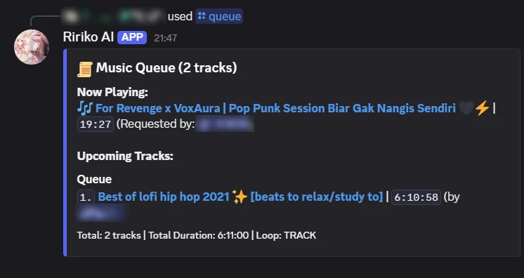
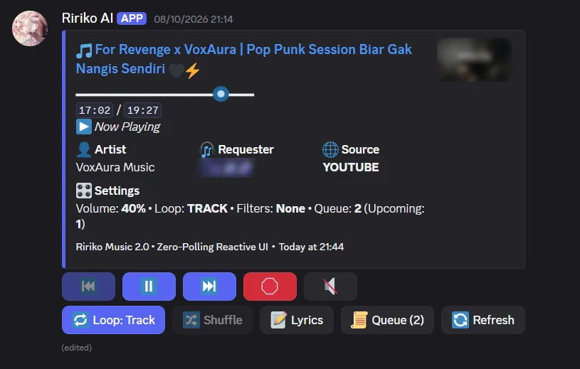

# Music

Ririko plays music from YouTube, Spotify, SoundCloud and direct links in a voice channel. It has a queue, a player message with buttons, audio filters, lyrics and personal playlists.

## 1. Turn It On

There are two parts: one for the host of the bot, and one for the server admin.

### 1.1. For the Host

Music works best with Lavalink. Lavalink is a separate program that plays the audio. Set it up once.

1. Follow the Lavalink steps in [SETUP.md](https://github.com/RirikoAI/RirikoBot/blob/master/SETUP.md) (source install) or [deployment.md](deployment.md) (Docker).
   The setup wizard (`ririko setup`) asks for this on the **Database & Music** page: run Lavalink on the same computer, use a Lavalink server you already have (it tests the address and the password), or, with Docker, the bundled Lavalink or a remote node.
2. Make sure `LAVALINK_ENABLED=true` in `.env`, and that the bot and Lavalink use the same `LAVALINK_PASSWORD`.
3. Optional: add Spotify keys (section 7).
4. Restart the bot.

If Lavalink is not available, Ririko falls back to a built-in player. The built-in player plays SoundCloud, Spotify and Deezer links (it finds the full song on SoundCloud), and direct audio links. It does not play YouTube links. Search uses SoundCloud.

#### Install FFmpeg for the built-in player

The built-in player needs FFmpeg. Lavalink does not. The Docker image already has FFmpeg, so skip this on Docker. Run `ririko doctor` to check that FFmpeg is found.

- Windows: run `winget install Gyan.FFmpeg` in a new terminal, or `choco install ffmpeg` as Administrator.
- Ubuntu and Debian: run `sudo apt update`, then `sudo apt install ffmpeg`.
- macOS: run `brew install ffmpeg`.

If FFmpeg is not on your `PATH`, set `FFMPEG_PATH` in `.env` to the full path of the program.

### 1.2. For the Server Admin

Music commands work in every server at once. You only need to set it up if you want the music channel or a DJ role.

1. Run `/setup-music` in the channel you want. You need the **Manage Server** permission.
2. Or open the dashboard **Music** page and pick the music channel there. See [dashboard.md](dashboard.md).

Ririko posts a player message in that channel. Members can type a song name or a link in the channel, and Ririko plays it. Ririko deletes those messages. Ririko needs to send and manage messages in that channel.

## 2. Play Music

1. Join a voice channel.
2. Run `/play query:<song name or link>`. Ririko joins your channel and starts to play.
3. Run `/play` again to add more songs. You can add a playlist link too.

Ririko leaves when you run `/stop` or `/leave`. With the default settings, it also leaves 3 minutes after the last member leaves the voice channel.

## 3. Commands

All music commands work in a server only.

| Command | Aliases | Options | What it does |
|---|---|---|---|
| `/play` | `p` | `query` (required) | Plays or queues a song, playlist or link. |
| `/pause` | | None | Pauses. |
| `/resume` | | None | Resumes. |
| `/skip` | `s`, `next` | None | Skips to the next song. |
| `/back` | `prev`, `previous` | None | Plays the previous song again. |
| `/stop` | | None | Stops, clears the queue and leaves. |
| `/queue` | `q`, `list` | `page` | Shows the queue, 10 songs on a page. |
| `/nowplaying` | `np` | None | Shows the current song and its progress. |
| `/volume` | `vol`, `v` | `level` (0 to 150) | Shows or sets the volume. |
| `/loop` | `repeat`, `l` | `mode` (`off`, `track` or `queue`) | Sets the loop mode. |
| `/shuffle` | `sh` | None | Shuffles the songs that wait in the queue. |
| `/seek` | | `timestamp` (required, such as `1:30`, `90` or `02:45`) | Jumps to a time in the song. |
| `/filter` | `f`, `effects` | `preset` (required) | Turns an audio filter on or off. |
| `/lyrics` | `ly` | `song` | Shows the lyrics of the current song, or of `song`. |
| `/join` | `connect`, `j` | None | Joins your voice channel. |
| `/leave` | `dc`, `disconnect` | None | Leaves the voice channel and clears the queue. |
| `/playlist` | `pl` | `action` (required), `name`, `query` | Manages your own playlists. |
| `/setup-music` | | `channel` (default: this channel) | Makes a channel the music channel. Needs **Manage Server**. |

Filter presets: `bassboost`, `nightcore`, `8d`, `vaporwave`, `treble`, `pop`, `soft`, `karaoke` and `normal`.

Playlist actions: `create` (needs `name`), `add` (needs `name` and `query`), `list`, `play` (needs `name`) and `delete` (needs `name`). Playlists belong to you.

Volume is 0% to 150%. Ririko will not go above 150% to protect hearing.

The `/queue` command shows the current song and the songs that wait:



## 4. Player Message

The player message in the music channel shows the current song and the queue. Ririko updates it when something changes. It has these buttons:

- Previous, Play/Pause, Skip, Stop
- Mute/Unmute
- Loop (changes between off, track and queue)
- Shuffle
- Lyrics (shows the lyrics only to you)
- Queue (shows the queue)
- Refresh



## 5. Server Settings

You need the **Manage Server** permission. Open the dashboard **Music** page.

| Setting | What it does |
|---|---|
| Default volume | The volume a new session starts at, 0 to 150. The default is 80. `/volume` changes it too. |
| Music channel | The channel for the player message. If you change it, Ririko posts a new player message there. It does not delete the old one. |
| DJ role | With a DJ role, only members with that role, or with Manage Server, can pause, resume, skip, go back, stop, change the volume, loop, shuffle, seek, use filters, or make Ririko leave. This works for commands and for the buttons. Everyone can still add songs and use the queue, now playing, lyrics and join. |
| Leave empty voice channels | When on (the default), Ririko stops and leaves 3 minutes after the last member (not counting bots) leaves. If someone joins, it stays. |

Audio filters are not saved. They reset with each session.

You can also use the command line: `ririko guild:config <server> music.<key> <value>`.

## 6. Lyrics

`/lyrics` and the Lyrics button get lyrics from [LRCLIB](https://lrclib.net). It is free and needs no key.

- With no `song`, Ririko uses the song that plays now.
- With `song`, Ririko searches for that text and uses the first result.
- Long lyrics are split into up to 10 embeds. Anything longer is cut.
- Ririko tells you when it finds no lyrics, when the song is instrumental, or when LRCLIB does not answer.

## 7. Spotify Keys (Host)

Add Spotify keys if you want members to play Spotify links and playlists. Ririko reads the song details from Spotify and plays the audio from another source. You can use either method, or both.

### 7.1. Spotify Developer App

1. Open the [Spotify Developer Dashboard](https://developer.spotify.com/dashboard) and sign in.
2. Click **Create app**. Enter a name and a short description.
3. Enter `http://localhost:8888/callback` as the redirect URI. Select **Web API**.
4. Open the app and go to **Settings**.
5. Copy the **Client ID**. Click **View client secret** and copy the secret.
6. Add them to `.env`:

   ```env
   SPOTIFY_CLIENT_ID="your_client_id"
   SPOTIFY_CLIENT_SECRET="your_client_secret"
   ```

### 7.2. Session Cookie

1. Open [open.spotify.com](https://open.spotify.com) and sign in.
2. Press `F12` to open the developer tools.
3. Open the **Application** tab (Chrome and Edge) or the **Storage** tab (Firefox).
4. Open **Cookies** and pick `https://open.spotify.com`.
5. Copy the value of `sp_dc`. Copy `sp_key` too if you want.
6. Add them to `.env`:

   ```env
   SPOTIFY_DC="your_sp_dc_value"
   SPOTIFY_KEY="your_sp_key_value"
   SPOTIFY_SP_DC="your_sp_dc_value"
   ```

Treat the cookie like a password. Never share it.

After you change Spotify values, run `pnpm lavalink:install` again (source install) and restart Lavalink and the bot.

## 8. Settings Reference for Hosts

| Variable | Default | What it does |
|---|---|---|
| `LAVALINK_ENABLED` | `true` | Turns Lavalink on or off. |
| `LAVALINK_HOST`, `LAVALINK_PORT` | `127.0.0.1`, `2333` | Where Lavalink runs. |
| `LAVALINK_PASSWORD` | `youshallnotpass` | The password. Change it. Use the same value for the bot and for Lavalink. |
| `LAVALINK_SECURE` | `false` | Use a secure connection to Lavalink. |
| `LAVALINK_YOUTUBE_CIPHER_URL` | Empty | Optional. The address of a cipher server for the YouTube plugin. Empty uses the plugin's own cipher. |
| `SPOTIFY_CLIENT_ID`, `SPOTIFY_CLIENT_SECRET` | Empty | Spotify Developer App keys. |
| `SPOTIFY_DC`, `SPOTIFY_KEY`, `SPOTIFY_SP_DC` | Empty | Spotify session cookies. |
| `FFMPEG_PATH` | `ffmpeg` | The FFmpeg program, for the built-in player. |
| `USE_PRIVATE_MUSIC_PACKAGE` | `false` | Loads an optional extra-sources package into the built-in player. The package has its own documents. Leave it `false` if you do not have it. |

Lavalink on another machine: see [deployment.md](deployment.md).

## 9. Limits

- You must be in a voice channel to start music. Ririko needs to see and join that channel and speak in it.
- The built-in player cannot play YouTube links. Use Lavalink for YouTube.
- The queue and the filters live in memory. They are lost when the bot restarts.
